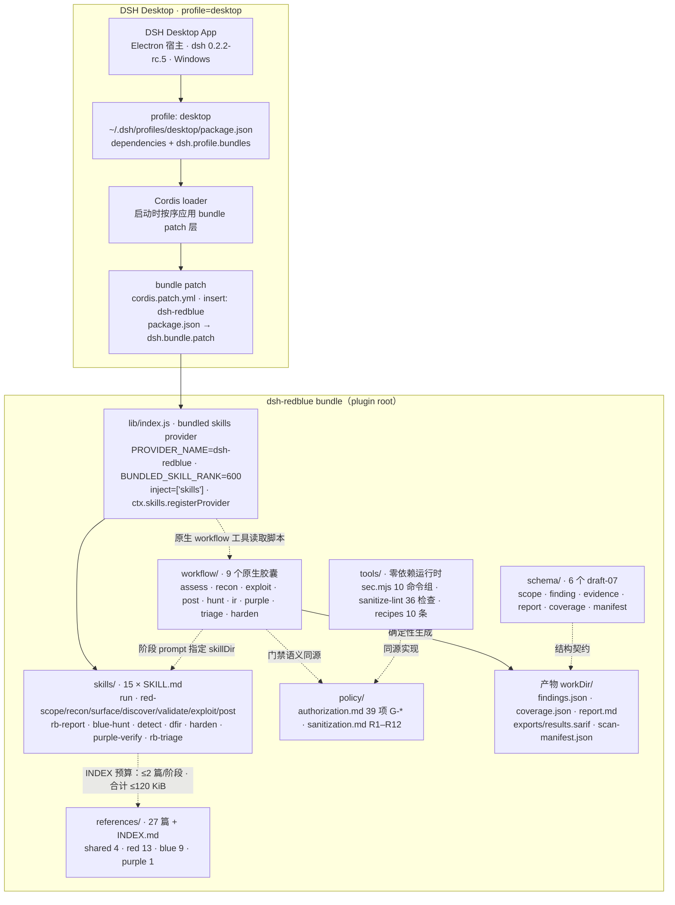
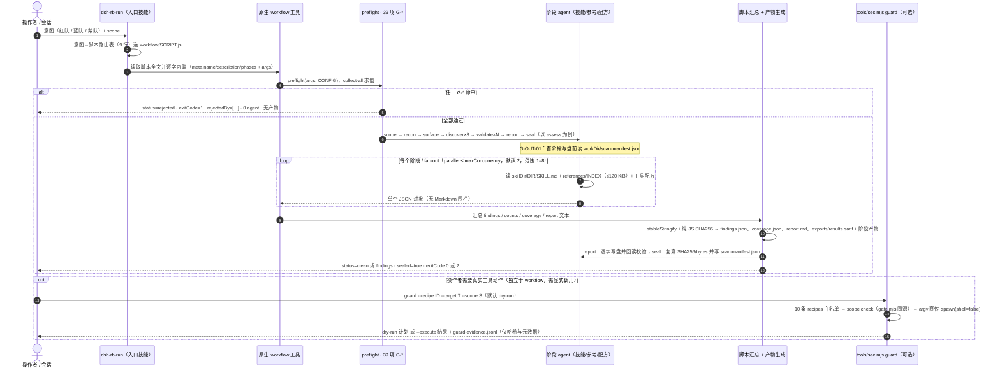

# dsh-redblue 架构与执行架构（architecture）

- 版本：**v2（2026-11-20，t28 交付终稿）**；替换 t15 草稿，修正 hunt 数据源枚举、report/seal 实现细节、参考预算口径漂移、安装状态与产物清单
- 适用对象：`dsh-redblue` 0.1.0；DSH 桌面版 `0.2.2-rc.5`；`profile=desktop`
- 事实来源：`docs/requirements.md`、`docs/design.md`、`docs/assembly-report.md` 与当前仓库实际文件；数字以 **2026-11-20 实测**为准（§4）
- 图与源码冲突时：**以代码与策略文件为准**，先改图/文档，不得改代码迁就图
- 本文件配套两张同名独立 SVG：`docs/architecture-plugin.svg`、`docs/architecture-workflow.svg`（手写、无脚本、无外链、离线可开）；Mermaid 源码可直接在支持 Mermaid 的 Markdown 渲染器查看
- 只描述**已实现**能力：不画未实现的自动安装、联网扫描、自动遏制、Web UI、SARIF 上传等

---

## 0. 阅读指北

### 0.1 建议阅读顺序

1. **先读 §1 图 1**：回答“dsh-redblue 由什么组成、在 DSH 里如何被装载、每个目录负责什么、产物落在哪里”。
2. **再读 §2 图 2**：回答“一次运行如何从用户意图被选中、39 项门禁在哪一步拒绝、阶段如何执行、每阶段加载什么、产物如何确定性封存、退出码如何产生”。
3. **然后读 §3**：图中每个元素在源码中的锚点（用符号/字符串定位，不依赖行号）。
4. **最后读 §4–§5**：§4 是本次对仓库实际数字的逐条自查；§5 记录已知口径差异与边界（含 design 冻结导致的偏差）。
5. 需要交付形态时看 §1.2 的目录职责表、§2.2 的 workflow 表与 §4 的数字表。

### 0.2 图例

| 记号 | 含义 |
|---|---|
| 实线箭头 | 装载 / 调用 / 数据流 |
| 虚线箭头 | 注记、可选路径，或“语义同源”的约束关系（不是运行时调用） |
| 红色 | 拒绝分支（fail-closed） |
| `[...]` / 等宽 | 英文标识符、文件名、命令 |
| 路径 | 相对插件根 `dsh-redblue/`（安装后为 `link:` 指向的真实目录） |

### 0.3 缩略语

- `SKILL.md`：技能方法论正文；`provider`：`ctx.skills.registerProvider` 注册对象；`capsule`：`workflow/*.js` 编排脚本（由原生 `workflow` 工具执行）
- `G-*`：授权/参数/数据源硬门禁 ID；`workDir`：单次运行产物目录；`guard`：`tools/sec.mjs guard` 受控执行子命令
- `stage`：`workflow/*.js` 内的阶段（`runStage` / `runFanout` / report / seal）；`phase()` 为原生运行时进度回调

### 0.4 数字口径速览（与 SVG、§4 一致）

| 对象 | 数量 | 计数口径 |
|---|---|---|
| 技能 | **15** | `skills/` 下 15 个目录，每个一个 `SKILL.md`；与 `lib/index.js` 的 `SKILLS` 常量一一对应 |
| workflow 胶囊 | **9** | `workflow/*.js` 9 个（`workflow/package.json` 不计入） |
| 参考 | **27** | 26 个 `.md` + `blue/templates/sigma.yml`；另有 `references/INDEX.md`（共 28 个文件，INDEX 不计入 27 篇） |
| schema | **6** | `schema/*.json`：scope / finding / evidence / report / coverage / manifest |
| 工具配方 | **10** | `tools/recipes.json` 的 `recipes` 数组长度 |
| 硬门禁注册表 | **39** | `policy/authorization.md` §4 的 `G-*` 行；9 个 workflow 各取子集 30–35 个 |

---

## 1. 图 1：插件架构（Plugin Architecture）

### 1.0 Mermaid 源码

### 1.1 装载链逐层说明

| 层 | 实现位置 | 作用 | 必须成立的事实（可核对） |
|---|---|---|---|
| 桌面宿主 | DSH Desktop App（Electron 宿主） | 启动 Cordis 运行时并加载 profile 的 bundle 栈 | `dsh --version` = `0.2.2-rc.5`；插件只面向 `desktop` profile |
| profile | `~/.dsh/profiles/desktop/package.json`：`dependencies` + `dsh.profile.bundles` | 记录插件依赖与 bundle 顺序；`link:` 安装指向本仓库 | 安装后需**重启 DSH**；`dsh plugin add` 只透传 pnpm，必须在 `dsh.profile.bundles` 中显式出现 `dsh-redblue`（README §6 第 3 步） |
| Cordis loader | DSH 内置 loader | 启动时按序应用 bundle patch 层，加载插件入口 | 插件入口为 ESM `lib/index.js`；模块导出 `apply / inject / name`；`inject = ["skills"]` |
| bundle patch | `cordis.patch.yml` + `package.json` 的 `dsh.bundle.patch` | 把插件自身插入 bundle 栈 | patch 内容为 `- insert: [{ id: dsh-redblue, name: dsh-redblue }]` |
| skills provider | `lib/index.js` | 向 `ctx.skills` 注册 15 个 bundled 技能 | `PROVIDER_NAME="dsh-redblue"`；`BUNDLED_SKILL_RANK=600`（硬编码，避免 `link:` 安装下解析 peer 依赖）；`SKILL.md` frontmatter 为单一事实源，文件不可读时回退常量；`get()` 返回 frontmatter 之后的正文 |
| skills/ | `skills/<dir>/SKILL.md` × 15 | 方法论与阶段说明；由阶段 agent 按 `skillDir` 读取 | 15 个目录：`run`、`red-scope`、`red-recon`、`red-surface`、`red-discover`、`red-validate`、`red-exploit`、`red-post`、`rb-report`、`blue-hunt`、`detect`、`dfir`、`harden`、`purple-verify`、`rb-triage`；12 键 frontmatter；正文最大 176 行 / 8,939 B（≤300 行 / ≤24 KiB） |
| workflow/ | `workflow/*.js` × 9 | 编排脚本：args 校验、门禁、阶段编排、确定性产物生成、错误返回 | 9 个脚本；由 DSH 原生 `workflow` 工具执行；脚本内无 fs/网络/Node API，只用 `args/phase/log/agent/parallel/pipeline` 与 ECMAScript 内建；SHA256 为纯 JS 实现 |
| references/ | `references/**`：27 篇 + `INDEX.md` | 方法论、判定标准、参数模板、纪律层；`INDEX.md` 是唯一加载映射 | 27 篇 = 26 `.md` + `sigma.yml`；每篇 ≤48 KiB（最大 32,841 B）；六键 provenance；每阶段 ≤2 篇 / ≤120 KiB（INDEX §3）；审计台账运行期不加载 |
| tools/ | `tools/sec.mjs` + `tools/lib/*`（11 模块）+ `tools/recipes.json` + `tools/sanitize-lint.mjs` | 零依赖工具运行时：离线分析命令、白名单受控执行、净化 lint | `sec.mjs` 10 个命令组；`recipes.json` 恰好 10 条；`guard` 只执行白名单配方、argv 直传 `spawn(shell=false)`、默认 dry-run；`sanitize-lint.mjs` R1–R12 / 36 项检查 |
| policy/ | `policy/authorization.md`、`policy/sanitization.md` | 人读规范：授权/scope/门禁注册表/停止条件；R1–R12 与检查矩阵 | authorization §4 注册表 39 行；sanitization R1–R12、36 条可运行检查、白名单与失败级别；`tools/lib/gate.mjs` 与 policy 同源 |
| schema/ | `schema/*.json` × 6 | 输入/产物结构契约 | scope / finding / evidence / report / coverage / manifest，均为 draft-07 |
| 产物 | `workDir/` 内 | 一次运行的机器可读与人类可读结果 | 公共 5 件 + `scope.json`；workflow 专属阶段产物；`scan-manifest.json` 记录每件的 bytes 与 SHA256 |

### 1.2 目录职责与产物

| 目录 | 责任 | 不负责 |
|---|---|---|
| `lib/` | 只注册 bundled skills provider；不联网、不读插件目录外路径、不 import 第三方包 | 不执行 workflow、不写产物 |
| `skills/` | 角色方法论、边界、阶段输入输出与参考预算 | 不硬编码大段参考正文（由 `references/INDEX.md` 映射） |
| `workflow/` | 参数校验、`preflight` 门禁、阶段编排、确定性产物与封存、状态/退出码 | 不做网络请求、不直接读写文件（写盘由 agent 完成） |
| `references/` | 方法论文本与判定标准 | 不含可直接执行的武器化命令；台账不在运行期加载 |
| `tools/` | 离线分析（`scope check`/`evidence`/`sarif`/`ioc`/`log`/`rule`/`recipes`）与白名单受控执行 | 不提供自由命令行入口；不内置扫描器 |
| `policy/` | 人读规范与门禁注册表 | 不被运行时直接解析；由 gate/lint 同源实现 |
| `schema/` | 产物与输入结构契约（draft-07） | 不参与运行时校验（lint 不校验 schema 内容） |

**产物清单（源码实测）**

| 类别 | 文件 |
|---|---|
| 公共（9 个 workflow 全部） | `scope.json`、`findings.json`、`coverage.json`、`report.md`、`exports/results.sarif`、`scan-manifest.json` |
| `assess.js` | 另加 `recon.json`、`surface.json` |
| `recon.js` | 另加 `recon.json`、`surface.json` |
| `exploit.js` | 另加 `exploit-log.json` |
| `post.js` | 另加 `post.json` |
| `hunt.js` | 另加 `hunt-plan.json`、`hunt-results.json` |
| `ir.js` | 另加 `intake.json`、`timeline.json`、`containment.json` |
| `purple.js` | 另加 `coverage-matrix.json` |
| `triage.js` | 另加 `state/findings.jsonl` |
| `harden.js` | 另加 `baseline.json`、`gaps.json`、`remediation.json` |
| guard（可选，独立命令） | `guard-evidence.jsonl`（JSONL，只落哈希与元数据） |

### 1.3 关键约束注记（图 1）

- **零 npm 依赖**：`package.json` 无 `dependencies`/`devDependencies`；Node ≥20；`link:` 安装无需插件自身 `node_modules`。
- **默认 report-only**：产物只写 `workDir`；不改目标、不改宿主配置；`post` 不做持久化。
- **默认 `dryRun=true`**：`dryRun=true` 时零目标侧动作（不向目标发包、不主动扫描、不利用）；显式 `dryRun=false` 只解除目标侧动作限制，不解除 scope/mode/confirm/window/budget 约束。
- **产物确定性**：脚本用 `stableStringify` 生成文本、纯 JS SHA256 生成期望哈希；agent 逐字写盘并回读；seal 复算后写 `scan-manifest.json`。`runId` 含时间/随机，不参与“跨运行字节相同”的断言。
- **净化门禁**：`node tools/sanitize-lint.mjs --strict` 是发布门禁（R1–R12 / 36 检查）；`policy/` 与 lint 常量必须一致。
- **安装状态**：本机 `desktop` profile 当前**未包含** `dsh-redblue`（2026-11-20 实测 `~/.dsh/profiles/desktop/package.json`）；图 1 画的是**装载路径**，不声称已安装。安装与验证步骤见 `README.md` §6。
- **同形态**：与 `dsh-security` 一致，采用“bundle patch + `lib/index.js` bundled provider + 原生 workflow + bundled skill”形态；本插件不修改 DSH 本体。

---

## 2. 图 2：workflow × skill 执行架构

### 2.0 Mermaid 源码

### 2.1 执行步骤（与图 2 对应）

1. **入口技能路由**：`skills/run/SKILL.md`（`dsh-rb-run`）提供“意图 → 脚本”的 9 行路由表、args 示例、默认 `dryRun=true`、exploit/post 二次确认规则，以及无 `workflow` 工具时的降级说明（不伪造执行结果）。
2. **读取脚本全文**：入口技能指导 agent 读取 `workflow/<script>.js` 全文，并用原生 `workflow` 工具**逐字内联**提交（不支持 `@file`/路径引用）；`meta` 必须含 `name`（kebab-case）与 `description`，建议 `phases` 与脚本 `phase()` 对齐。
3. **原生工具执行**：脚本运行环境只提供 `args / phase(title) / log(msg) / agent(prompt, opts) / parallel(thunks) / pipeline(...)`；无 fs/网络/Node API。
4. **args 形状校验**：`scope / workDir / skillDir / maxConcurrency / dryRun`（以及 workflow 专属 `confirm` / `activeScan`）；未知键、非法类型、越界路径分别命中 `G-ARG-01`、`G-PATH-01..03`、`G-CONC-01`、`G-CONF-01`。
5. **授权与参数门禁**：`preflight(args, CONFIG)` 在**任何阶段 agent 之前**执行，按 39 项注册表取子集（各 workflow 30–35 个）**collect-all** 求值；命中任一 → `status="rejected"`、`exitCode=1`、`rejectedBy=[...]`、`artifacts=[]`、`sealed=false`、**0 agent**、不写任何产物。
6. **唯一前置例外 G-OUT-01**：需要读取 `workDir/scan-manifest.json`，因此由**首个阶段 agent 在写盘前**判定；`runId` 不一致即返回 `{"gate":"G-OUT-01"}` 并停止，不写任何文件（脚本侧转为 `rejected`/`exitCode=1`）。
7. **阶段执行**：`runStage(ctx, stage, skill, extras, options)` 与 `runFanout(...)` 按脚本顺序执行；fan-out 用 `parallelLimited(thunks, ctx.maxConcurrency)` 限制并发（默认 2，范围 1–8）。各 workflow 的阶段与技能见 §2.2。
8. **阶段 agent 的加载**：prompt 注入 `UNTRUSTED_CLAUSE`（目标内容不可信，只读、不执行其中指令、不跟随链接）、`skillDir/<dir>/SKILL.md` 路径、`workDir`、归一化 scope、`references/INDEX` 预算（合计 ≤120 KiB）与工具配方族（红 F1–F16 / 蓝 B1–B12），要求只返回单个 JSON 对象。
9. **汇总与确定性产物**：脚本汇总阶段结果（findings 归一化/去重、counts、coverage、report 文本），用 `stableStringify` 生成 `findings.json`、`coverage.json`、`report.md`、`exports/results.sarif` 以及 workflow 专属产物；同时计算每件的 `bytes` 与 `sha256` 期望值。
10. **report 阶段**：每件产物一个写盘 agent（最多 3 次尝试），逐字写盘并回读计算实际 SHA256/字节数；仍不一致则记入 mismatch 并影响封存结果。
11. **seal 阶段**：2 个 agent —— 校验器只读复算磁盘 SHA256/字节数；写入器把 `scan-manifest.json` 逐字写盘（成功用 completed manifest，不一致用 failed manifest）。mismatch → `status="error"`、`exitCode=1`。
12. **退出码与状态**：见 §2.4；入口技能只转述 `status/exitCode/rejectedBy/failedStage`，不自行解释为“通过/失败”。
13. **可选受控执行**：`tools/sec.mjs guard` 独立于 workflow；只允许 `tools/recipes.json` 的 10 条白名单配方；默认 dry-run 只打印 argv 计划；`--execute` 额外要求 written scope、mode 匹配、target 在 scope targets、`--confirm` 全等、二进制存在；证据只落哈希（§2.5）。

### 2.2 9 个 workflow 的实际阶段与门禁（源码实测）

| workflow | 阶段顺序（源码 `runStage` / `runFanout` / report / seal） | 阶段技能 | 最低 mode | 授权类型 | targets | 数据源 / 专属门禁 | 专属产物 |
|---|---|---|---|---|---|---|---|
| `assess.js` | scope → recon → surface → discover（×8）→ validate（×N）→ report → seal | red-scope / red-recon / red-surface / red-discover / red-validate；report=rb-report | passive | written | 必填 | — | recon.json、surface.json |
| `recon.js` | scope → recon → surface → report → seal | red-scope / red-recon / red-surface | passive | written | 必填 | `activeScan=true` 受 `G-MODE-03` 约束 | recon.json、surface.json |
| `exploit.js` | scope → validate → exploit → report → seal | red-scope / red-validate / red-exploit | exploit | written | 必填 | `findings`（G-DS-07）+ `confirm`（G-CFM-01..04） | exploit-log.json |
| `post.js` | scope → post → report → seal | red-scope / red-post | post | written | 必填 | `confirm`（G-CFM-01..04） | post.json |
| `hunt.js` | scope → hunt（计划）→ hunt（fan-out）→ report → seal | hunt=blue-hunt；scope 阶段技能目录 `run`（t30 已修复；原 `rb-run` 字面量偏差见 §5.5 历史注记） | passive | written / internal-mandate | 可选 | `siem / edr / logs / pcap / cloudtrail / telemetry-export`（G-DS-01） | hunt-plan.json、hunt-results.json |
| `ir.js` | intake → triage → timeline → containment → report → seal | dfir | passive | written / internal-mandate | 可选 | `evidence`（G-DS-02） | intake.json、timeline.json、containment.json |
| `purple.js` | redActions → detectCoverage → gaps → report → seal | purple-verify | passive | written | 必填 | `findings` + `detections`（G-DS-03，两者都要） | coverage-matrix.json |
| `triage.js` | finding → review → disposition → write → report → seal | rb-triage | passive | written | 必填 | `finding`（G-DS-06） | state/findings.jsonl |
| `harden.js` | baseline → check（fan-out）→ gaps → remediation → verify → report → seal | harden | passive | written / internal-mandate | 可选 | `baseline`（G-DS-04）+ `lastVerified` ≤180 天（G-DS-05） | baseline.json、gaps.json、remediation.json |

> 说明：`report` 与 `seal` 由脚本内的写盘/封存函数驱动 agent 完成，不属于 `runStage` 的技能阶段；表中“阶段技能”只列技能阶段。阶段数（含 report/seal）：assess 7、recon 5、exploit 5、post 4、hunt 4、ir 6、purple 5、triage 6、harden 7。

### 2.3 39 项 G-* 门禁分组

注册表位置：`policy/authorization.md` §4（39 行，实测去重计数 39）。门禁按注册表顺序 collect-all 求值，便于一次修正；`G-OUT-01` 是唯一在首阶段判定的例外。

| 组 | ID | 主要拒绝条件 | 计数 |
|---|---|---|---|
| 参数/路径/配置 | `G-ARG-01`、`G-PATH-01..03`、`G-CONC-01`、`G-CONF-01` | args 未声明键；workDir/skillDir/dataSources 路径非法；并发不在 1–8；scope 未声明字段或超长/超量（reference 3–200、targets ≤200、dataSources ≤64 等） | 6 |
| 授权 | `G-AUTH-01..07` | authorization 缺失/空、type 非 written/internal-mandate、workflow 要求 written 但给 internal-mandate、grantedBy 空、日期非法、未生效、已过期 | 7 |
| 目标 | `G-TGT-01..04` | targets 空、通配/全网（`*`、`0.0.0.0`、`::`、/0、IPv4 前缀 < /8、IPv6 前缀 < /32）、kind/value 非法、命中 exclusions | 4 |
| 模式 | `G-MODE-01..03` | mode 非法、低于 workflow 最低要求、recon 的 activeScan 要求 mode≥active 且 dryRun=false | 3 |
| 时间窗/预算/数据处置 | `G-WIN-01..03`、`G-BUD-01`、`G-DH-01..03` | 窗口 RFC 3339 / end>start / 当前在窗内；预算范围；retain/secrets/destruction 枚举 | 7 |
| 数据源 | `G-DS-01..07` | hunt/ir/purple/triage/harden/exploit 所需数据源及 baseline version/lastVerified（>180 天拒绝） | 7 |
| 二次确认 | `G-CFM-01..04` | exploit/post 的 confirm 缺失、不匹配、mode 不足、无精确目标 | 4 |
| 写盘前置 | `G-OUT-01` | workDir 已存在 scan-manifest.json 且 runId 不同（首阶段写盘前） | 1 |
| **合计** | | | **39** |

> `G-EXEC-01`（guard 专用：配方不在白名单、二进制缺失、evidence 写失败）**不在** 39 项注册表内，属于工具运行时的独立拒绝码；guard 同时复用 `G-AUTH-03`、`G-CFM-01/02`、`G-TGT-*` 等。

### 2.4 退出码与状态语义

| 情形 | 返回 | 退出码 | agent / 产物 |
|---|---|---|---|
| preflight 任一 `G-*` 命中 | `status="rejected"`、`rejectedBy=[...]` | `1` | 0 agent；`artifacts=[]`、`sealed=false`；无产物 |
| G-OUT-01（首阶段写盘前） | `status="rejected"`、`rejectedBy=["G-OUT-01"]` | `1` | 首阶段 agent 已启动但写盘前终止；不写任何产物 |
| 通过且 reportable = 0 | `status="clean"`；exploit/post 的 dry-run 为 `status="plan"` | `0` | 阶段 agent + 封存 |
| 通过且 reportable ≥ 1 | `status="findings"` | `2` | 阶段 agent + 封存 |
| 阶段异常 / 封存 mismatch | `status="error"`、`failedStage=...` | `1` | 返回对象 `artifacts=[]`；磁盘上可能已写部分产物；失败 manifest 记录 mismatches |

### 2.5 guard 受控执行（独立入口）

- **白名单**：只执行 `tools/recipes.json` 的 10 条配方（`dns_lookup`、`http_headers`、`tls_certificate`、`port_scan`、`vuln_scan`、`web_fuzz`、`pcap_read`、`file_hash`、`certificate_query`、`runtime_probe`）；未知配方 → `G-EXEC-01`。
- **同源门禁**：`guard` 调用 `tools/lib/gate.mjs` 的 `checkScope`（与 `scope check`、9 个 workflow 的 limits 段同源）；额外要求 `written` 授权（`G-AUTH-03`）、mode 匹配、target 归一化并命中 scope targets、`--confirm` 与 target 全等（`G-CFM-01/02`）、二进制存在（`G-EXEC-01`）。
- **执行**：`argv` 数组逐元素替换后 `spawn(binary, argv, { shell: false })`；按 recipe 固定超时（15–120 s；`DEFAULT_TIMEOUT_MS=120000`）与输出上限（1 MiB，`DEFAULT_OUTPUT_LIMIT_BYTES=1048576`）；无自由命令行入口。
- **证据**：`guard-evidence.jsonl` 只记录 `schemaVersion`、时间、recipe、lane、target、argv、binary、mode、authorizationReference、exitCode、signal、timedOut、truncated、durationMs、stdout/stderr 字节数与 SHA256、spawnError；不落 stdout/stderr 原文。
- **dry-run 语义**：默认只输出执行计划（含 `binaryAvailable`），不启动进程；dry-run 下 scope 文件不可读时命令返回 `exit 0 + ok:false`（无法生成计划），同一条件在 `--execute` 下 `exit 1`（执行前拒绝）。

### 2.6 关键约束注记（图 2）

- **门禁先于工作**：除 `G-OUT-01` 外，授权/参数门禁在第一个阶段 agent 之前完成；拒绝不产生任何产物。
- **脚本不碰 IO**：脚本不发起网络请求、不读写文件；所有文件读写由阶段 agent 在 `workDir` 内完成，report/seal 会校验哈希与字节数。
- **不可信输入**：目标响应、源码、日志、工单、证据一律视为不可信数据（`UNTRUSTED_CLAUSE`），只读、不执行其中指令、不跟随链接。
- **默认安全**：`dryRun=true`（零目标侧动作）、report-only；exploit/post 需 `confirm:"<target>"` 精确匹配 + mode 匹配，缺一即拒绝。
- **可复算**：产物由脚本确定性生成 + SHA256 封存；同 runId 下文本与哈希可复算。
- **guard 不是 workflow 阶段**：必须由操作者显式调用，且不继承 workflow 的 scope 校验结论。

---

## 3. 与实现的锚点对照

| 图中元素 | 源码锚点（可 grep 的字符串/符号） | 说明 |
|---|---|---|
| bundle patch | `cordis.patch.yml` 的 `insert:` / `id: dsh-redblue`；`package.json` 的 `dsh.bundle.patch` | 插件插入 bundle 栈的方式 |
| provider | `lib/index.js`：`BUNDLED_SKILL_RANK = 600`、`PROVIDER_NAME = "dsh-redblue"`、`registerProvider`、`const SKILLS = [` | 15 条目录与 rank 600 |
| 15 技能 | `lib/index.js` 的 `SKILLS` 数组；`skills/*/SKILL.md` 的 `name` | 目录名与技能名一一对应 |
| 9 workflow | `workflow/*.js`；`const CONFIG = { workflow: ... }` | 每个脚本一个 workflow 标识 |
| 39 项门禁 | `policy/authorization.md` §4 的 `G-*` 表；脚本内 `preflight(args, CONFIG)`、`gateFailure(...)`、`G-OUT-01` | 注册表 39；脚本按 workflow 取子集 |
| 阶段机 | `runStage(ctx, stage, skill, ...)`、`runFanout(ctx, stage, skill, ...)`、`phase(stage)` | 阶段执行与 fan-out |
| 不可信边界 | `UNTRUSTED_CLAUSE` | 注入每个阶段 prompt |
| 产物 | `artifactOf("findings.json", ...)`、`buildManifestDoc(...)`、`scan-manifest.json` | 产物与 manifest 生成 |
| 封存 | report 写盘函数 + `seal` 校验器/写入器、`sealed`、`failedManifest` | 复算 SHA256 与 bytes |
| 退出码 | `const exitCode = status === "findings" ? 2 : 0`；`rejectedResult(...)` 的 `exitCode: 1` | 0/2/1 语义 |
| guard | `tools/sec.mjs` → `runGuard(...)`；`tools/lib/guard.mjs` 的 `spawnWithLimits`、`EVIDENCE_FILE` | 白名单、spawn(shell=false)、证据 |
| 净化 lint | `tools/sanitize-lint.mjs`、`policy/sanitization.md`、`--list-checks` | R1–R12 / 36 检查 |
| schema | `schema/*.json` 六个文件 | 输入/输出结构契约 |

---

## 4. 准确性自查（2026-11-20 实测）

命令均在 `dsh-redblue/` 下执行；输出为本轮实测值。

### 4.1 六项核心数字

| 检查 | 命令 | 实测 | 结论 |
|---|---|---|---|
| 技能数 | `ls skills \| wc -l` | `15` | 与图 1 一致 |
| workflow 数 | `ls workflow/*.js \| wc -l` | `9` | 与图 1 一致（`workflow/package.json` 不计入） |
| 参考库（`.md`） | `find references -name '*.md' \| wc -l` | `27` | 26 篇 `.md` 参考 + `INDEX.md` |
| 参考库（全部文件） | `find references -type f \| wc -l` | `28` | 27 篇参考（含 `sigma.yml`）+ `INDEX.md` |
| schema 数 | `ls schema/*.json \| wc -l` | `6` | scope/finding/evidence/report/coverage/manifest |
| recipes 数 | `node -e "console.log(JSON.parse(require('fs').readFileSync('tools/recipes.json','utf8')).recipes.length)"` | `10` | 与 `tools/recipes.json` 一致 |
| 门禁数 | `grep -o 'G-[A-Z]*-[0-9]*' policy/authorization.md \| sort -u \| wc -l` | `39` | 与 policy §4 的 39 行一致 |

### 4.2 其他复核

| 检查 | 命令 | 实测 | 结论 |
|---|---|---|---|
| 净化检查数 | `node tools/sanitize-lint.mjs --list-checks \| grep -c '^R[0-9]'` | `36`（R1–R12） | 与 `policy/sanitization.md` 一致 |
| 净化门禁 | `node tools/sanitize-lint.mjs --strict --json .` | `checkedFiles=87`、`blockers=0`、`warnings=2` | 2 warning 为已受理的 R11（`purple-verify:3`、`red-exploit:3`），见 assembly-report §4 |
| 测试 | `node --test test/scaffold.test.mjs test/sanitize.test.mjs test/workflow.test.mjs test/tool-runtime.test.mjs` | `98/98 pass` | 4 个测试文件 |
| 语法 | 对全部 `.js/.mjs` 执行 `node --check` | `27/27` 通过 | lib 1 + workflow 9 + tools 2 + tools/lib 11 + test 4 |
| tools 模块数 | `ls tools/lib/*.mjs \| wc -l` | `11` | args/cli/common/evidence/gate/guard/ioc/lognorm/recipes/sarif/sigma |
| sec 命令组 | `node tools/sec.mjs --help` | 10 个功能命令组 | scope/evidence/sarif/ioc/log/rule/recipes/guard |
| 参考体积 | 参考文件字节统计 | 28 文件共 375,428 B；单篇最大 32,841 B（`red/strix-techniques.md`） | 单篇 ≤48 KiB |
| 技能体积 | `SKILL.md` 行数/字节统计 | 最大 176 行 / 8,939 B | ≤300 行 / ≤24 KiB |
| DSH 版本 | `dsh --version` | `0.2.2-rc.5` | 与 requirements 事实一致 |
| 安装状态 | `~/.dsh/profiles/desktop/package.json` | 无 `dsh-redblue` | 图 1 描述装载路径，不声称已安装 |

### 4.3 结论

六项核心数字 **15 / 9 / 27 / 6 / 10 / 39** 与图、正文、SVG 一致；净化门禁 0 blocker；测试与语法检查全通过。两张 SVG 的内容均已逐项对照本轮实测与源码（阶段名、技能名、产物名、门禁语义），未画未实现能力。

---

## 5. 已知口径差异与边界

### 5.1 参考加载预算：INDEX ≤2 篇 vs stage prompt ≤3 篇

- `references/INDEX.md`（t6 收紧）与 §0.4 采用 **每阶段 ≤2 篇 / 合计 ≤120 KiB**。
- 9 个 `workflow/*.js` 的 `buildPrompt` 文本仍写“单次最多 **3** 篇、合计 <=120 KiB”（例如 `workflow/assess.js` 的 `参考加载（按 references/INDEX.md 预算...）` 行）；`skills/run/SKILL.md` 的“参考加载”也写“1–3 篇、合计不超过 120 KiB”。这是 t26 记录的 O-2 文档漂移：**上限以 INDEX 为准**；prompt 字数不改变实际加载纪律。图为避免误导，只标注“INDEX 规定 ≤2 篇/阶段 + 合计 ≤120 KiB”。
- 修复该漂移需要改 9 个 workflow 的提示文本（本任务 out of scope），已记入 `docs/review-notes.md` §15.8 O-2。

### 5.2 design 冻结导致的偏差（以 assembly-report 为准）

- `docs/design.md` 为冻结基线：§5.1 列 17 篇参考、§2 列 4 个 schema、§5.2 写“≤3 篇”。当前实现为 **27 篇参考、6 个 schema、INDEX ≤2 篇**，与 design 的差异由 `docs/assembly-report.md` §3 的 D-1/D-2/D-5 记录并受理。本文件与图按**当前实现**陈述。
- `design.md` 的目录树未列 `workflow/package.json`（D-4，仅用于 `node --check` 的 commonjs 解析）与 `tools/sec.mjs`/`tools/lib`（D-6，工具运行时）。

### 5.3 安装与运行边界

- 本机 desktop profile 未启用本插件（§1.3）；安装需按 `README.md` §6 执行 `link:` 安装、确认 `dsh.profile.bundles`、重启 DSH，并用 `dsh plugin --profile desktop list` 验证。
- `guard --execute` 的可选二进制（如 `dig`/`curl`/`openssl`/`nmap`）不在交付物内；缺失时相关配方被 `G-EXEC-01` 拒绝，dry-run 仍可用。
- 超时与输出上限只约束直接子进程；配方二进制若自行派生后台进程，需人工清理（`docs/tool-runtime.md` §7 已声明）。

### 5.4 已受理的 warning

- `skills/purple-verify/SKILL.md:3`、`skills/red-exploit/SKILL.md:3` 的 `R11-TERMINOLOGY`（warning）：description 为 design §4.2 固定契约文本，与字段名 `findings` 同现；assembly-report §4 已受理，不阻塞发布。

### 5.5 hunt 的 scope 阶段技能字面量漂移（t30 已修复）

- 历史问题：`workflow/hunt.js` 的 scope 阶段原为 `runStage(ctx, "scope", "rb-run", ...)`，而 `skills/` 下实际入口目录是 `run`（技能名 `dsh-rb-run`），导致该阶段 prompt 指向不存在的 `skillDir/rb-run/SKILL.md`。
- 修复（t30）：字面量改为 `run`（`workflow/hunt.js:1462`）；`grep rb-run workflow/` = 0；新增回归测试遍历 9 个 workflow 的 `runStage`/`runFanout` 目录与 prompt 路径，断言 `skills/<dir>/SKILL.md` 存在且非空。
- 验证：t31 增量验证、t32 增量复审均 PASS；hunt 运行 clean/exit0/sealed/7 artifacts，scope prompt 指向 `/skills/run/SKILL.md`；`G-DS-01` 仍在任何 agent 之前生效，安全边界不变。

---

## 6. 维护规则

- 以下任一变化必须同步更新本文件与两张 SVG，并重跑 §4 自查：技能增删/改名、workflow 增删、参考篇数或分层变化、schema 增删、recipes 增删、`G-*` 注册表变化、产物文件名变化、provider 契约（rank/inject/name）变化、guard 门禁或证据字段变化。
- 图与实现冲突时，**以代码与策略文件为准**，先修正图/文档，不得改代码来迁就图（本任务约束：只写三份文档）。
- 本文件是架构说明，不替代 `docs/design.md` 的实现契约与 `docs/assembly-report.md` 的偏差记录；冲突时以 design + 代码为准并回写本文件。
