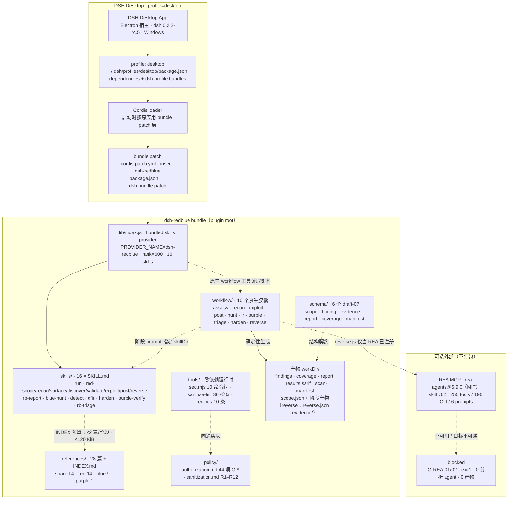
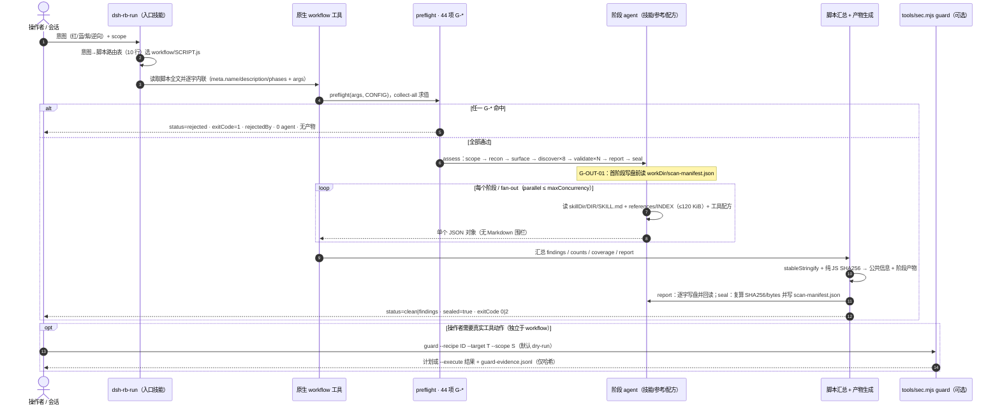
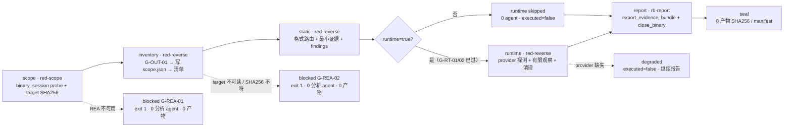

# dsh-redblue 架构与执行架构（architecture）

- 版本：**v3（2026-11-20，t43 v0.2.0 文档收口）**；在 v2（t28）基础上同步 16 技能 / 10 workflow / 28 参考 / 44 门禁与可选 REA 逆向 lane
- 适用对象：`dsh-redblue` **0.2.0**；DSH 桌面版 `0.2.2-rc.5`；`profile=desktop`（本机已 link 安装 0.2.0）
- 事实来源：`docs/requirements.md`、`docs/design.md`（v0.1 冻结）、`docs/design-addendum-v0.2-reverse.md`、`docs/assembly-report.md`、`policy/authorization.md` 与当前仓库实测（§4）
- 图与源码冲突时：**以代码与策略文件为准**，先改图/文档，不得改代码迁就图
- 本文件配套两张独立 SVG：`docs/architecture-plugin.svg`、`docs/architecture-workflow.svg`（手写、无脚本、无外链、离线可开）
- 只描述**已实现**能力；可选外部 REA 以虚线标注，不画未实现的自动安装/自动利用

---

## 0. 阅读指北

### 0.1 建议阅读顺序

1. **§1 图 1**：插件由什么组成、在 DSH 如何装载、16 技能/10 workflow/28 参考/44 门禁如何分层，以及 REA 为何是“可选外部 MCP”。
2. **§2 图 2**：一次 assess 运行如何从意图到封存；再看 §2.2 的 **reverse（第 10 个 workflow）阶段图**，理解探测、blocked、runtime skip 与证据包。
3. **§3**：图中元素在源码中的锚点（用符号/字符串定位，不依赖行号）。
4. **§4–§5**：§4 是本次对仓库实际数字的实测；§5 记录已知限制与文档债（REA 缺陷、schema/report 缺口、run/lib 漂移等）。
5. 交付形态看 §1.2 目录职责、§2.3 workflow 表、§4 数字表。

### 0.2 图例

| 记号 | 含义 |
|---|---|
| 实线箭头 | 装载 / 调用 / 数据流 |
| 虚线箭头/虚线框 | 可选、外部、注记，或“语义同源”的约束关系（不是运行时调用） |
| 红色 | 拒绝/阻塞分支（fail-closed / blocked） |
| `[...]` / 等宽 | 英文标识符、文件名、命令 |
| 路径 | 相对插件根 `dsh-redblue/` |

### 0.3 缩略语

- `SKILL.md`：技能正文；`provider`：`ctx.skills.registerProvider` 注册对象；`capsule`：`workflow/*.js` 编排脚本（由原生 `workflow` 工具执行）
- `G-*`：授权/参数/数据源硬门禁；`workDir`：单次运行产物目录；`guard`：`tools/sec.mjs guard` 受控执行
- `REA`：Reverse Engineering Agent MCP server（外部可选，不打包）；`probe`：reverse 第一个 REA agent 的 `binary_session` 能力探测
- `blocked`：能力缺失（REA 不可用/目标不可读）时的状态；`degraded`：provider/格式缺失但仍可静态继续

### 0.4 数字口径速览（与 SVG、§4 一致）

| 对象 | 数量 | 计数口径 |
|---|---|---|
| 技能 | **16** | `skills/` 16 目录；v0.1 15 + `red-reverse` |
| workflow 胶囊 | **10** | `workflow/*.js` 10 个（`package.json` 不计） |
| 参考 | **28** | 27 篇 v0.1 + 1 篇 `red/reverse-artifacts.md`；另 `INDEX.md`（共 29 个文件） |
| schema | **6** | scope/finding/evidence/report/coverage/manifest |
| 工具配方 | **10** | `tools/recipes.json` |
| 硬门禁注册表 | **44** | 39 项 v0.1 冻结 + 5 项 v0.2（`G-TGT-05`、`G-REA-01/02`、`G-RT-01/02`）；9 个 v0.1 workflow 各取子集 30–35，reverse 取 32 |

---

## 1. 图 1：插件架构（Plugin Architecture）

### 1.0 Mermaid 源码

### 1.1 装载链与分层说明

| 层 | 实现位置 | 作用 | 必须成立的事实 |
|---|---|---|---|
| 桌面宿主 | DSH Desktop App（Electron 宿主） | 启动 Cordis 运行时并加载 profile 的 bundle 栈 | `dsh --version` = `0.2.2-rc.5`；插件面向 `desktop` profile |
| profile | `~/.dsh/profiles/desktop/package.json` | 记录依赖与 bundle 顺序 | 本机实测：`dsh-redblue` 为 `link:C:/dsh-workspace/branch1/dsh-redblue`，`dsh.profile.bundles` 含 `dsh-redblue`（0.2.0） |
| Cordis loader | DSH 内置 loader | 按序应用 patch，加载入口 | 入口 ESM `lib/index.js`；模块导出 `apply / inject / name`；`inject = ["skills"]` |
| bundle patch | `cordis.patch.yml` + `package.json` 的 `dsh.bundle.patch` | 把插件插入 bundle 栈 | `insert: [{ id: dsh-redblue, name: dsh-redblue }]`；注释仍写 v0.1 “15 个”（见 §5.5 V-5，不影响运行） |
| skills provider | `lib/index.js` | 向 `ctx.skills` 注册 16 个 bundled 技能 | `PROVIDER_NAME="dsh-redblue"`；`BUNDLED_SKILL_RANK=600`；frontmatter 单一事实源，文件不可读时回退常量；`get()` 返回 frontmatter 之后的正文 |
| skills/ | `skills/<dir>/SKILL.md` × 16 | 方法论与阶段说明 | 16 目录：`run`、`red-scope`、`red-recon`、`red-surface`、`red-discover`、`red-validate`、`red-exploit`、`red-post`、`red-reverse`、`rb-report`、`blue-hunt`、`detect`、`dfir`、`harden`、`purple-verify`、`rb-triage`；12 键 frontmatter；最大 198 行 / 16,870 B（≤300 行 / ≤24 KiB） |
| workflow/ | `workflow/*.js` × 10 | 编排：args、门禁、阶段、确定性产物、封存 | 10 脚本；原生 `workflow` 工具执行；无 fs/网络/Node API；`reverse.js` 增加 probe/blocked/runtime/evidence 处理 |
| references/ | 28 篇 + `INDEX.md` | 方法论、路由、判定标准、纪律层 | 28 篇 = 27 `.md` + `sigma.yml`；另有 `INDEX.md`（共 29 文件）；单篇 ≤48 KiB（最大 32,841 B）；六键 provenance；每阶段 ≤2 篇 / ≤120 KiB；审计台账与 REA 平台矩阵按需加载 |
| tools/ | `tools/sec.mjs` + `tools/lib/*`（11 模块）+ `recipes.json` + `sanitize-lint.mjs` | 离线分析、白名单受控执行、净化 lint | 10 命令组；10 配方；guard 默认 dry-run；R1–R12 / 36 检查 |
| policy/ | `authorization.md`、`sanitization.md` | 人读规范 | 44 项 `G-*`（39 冻结 + 5 v0.2，§4 第 151–155 行）；§4.1 第 165–182 行记录 REA 外部依赖、blocked 与 runtime；R1–R12 |
| schema/ | `schema/*.json` × 6 | 输入/产物结构契约 | draft-07；**未扩展 enum**（report.status 不含 `blocked`，见 §5.5 V-3） |
| 产物 | `workDir/` | 一次运行结果 | 公共 5 + `scope.json`；reverse 另加 `reverse.json`、`evidence/rea-evidence.json`；manifest 记录 bytes/SHA256 |
| **REA（外部可选）** | 宿主 MCP（`rea-agents@6.9.0`，MIT） | 逆向能力探测、静态分析、证据导出 | **不打包**、不自动安装；缺失时 reverse 返回 `blocked`；provider 缺失降级；`open_binary` 只启引擎不执行样本 |

### 1.2 目录职责与产物

| 目录/层 | 责任 | 不负责 |
|---|---|---|
| `lib/` | 注册 bundled skills provider（16） | 不执行 workflow、不写产物 |
| `skills/` | 方法论、边界、阶段 I/O；`red-reverse` 承载 REA lane 路由/证据/降级 | 不硬编码参考正文 |
| `workflow/` | 参数/门禁/阶段编排/确定性产物；reverse 的 probe、blocked、runtime、证据包 | 不联网、不直接读写文件（写盘由 agent 完成） |
| `references/` | 方法论与判定标准；`reverse-artifacts` 提供 REA 路由/平台矩阵/K-1..K-12 | 不复制上游原文；不打包运行时 |
| `tools/` | 离线分析（scope/evidence/sarif/ioc/log/rule/recipes）与 guard | 不提供自由命令行；不内置 REA |
| `policy/` | 人读规范/门禁注册表 | 不被运行时直接解析 |
| `schema/` | 结构契约 | 不参与运行时校验 |
| **REA MCP** | 外部逆向引擎与工具面（Ghidra/JADX/ADB/WABT 等） | **不是** npm 依赖；不随插件分发 |

**产物清单（源码实测）**

| 类别 | 文件 |
|---|---|
| 公共（10 workflow 全部） | `scope.json`、`findings.json`、`coverage.json`、`report.md`、`exports/results.sarif`、`scan-manifest.json` |
| `assess.js` / `recon.js` | 另加 `recon.json`、`surface.json` |
| `exploit.js` / `post.js` | `exploit-log.json` / `post.json` |
| `hunt.js` / `ir.js` | `hunt-plan.json`、`hunt-results.json` / `intake.json`、`timeline.json`、`containment.json` |
| `purple.js` / `triage.js` / `harden.js` | `coverage-matrix.json` / `state/findings.jsonl` / `baseline.json`、`gaps.json`、`remediation.json` |
| `reverse.js` | `reverse.json`、`evidence/rea-evidence.json`（证据包，SHA256 登记/封存；`deterministic=false`） |
| guard（可选） | `guard-evidence.jsonl`（仅哈希与元数据） |

### 1.3 可选 REA 逆向 lane（分层）

| 层 | 组件 | 是否打包 | 运行期 |
|---|---|---|---|
| 技能层 | `skills/red-reverse/SKILL.md`（`dsh-red-reverse`，risk=passive/requires=authorization） | 是 | scope/inventory/static/runtime 阶段 |
| 参考层 | `references/red/reverse-artifacts.md`（路由/平台矩阵/K-1..K-12，MIT 派生） | 是 | 按 INDEX 预算加载 |
| 编排层 | `workflow/reverse.js`（scope→inventory→static→[runtime]→report→seal） | 是 | 第 10 个原生胶囊 |
| 门禁层 | `G-TGT-05`、`G-REA-01/02`、`G-RT-01/02` | 是（策略/代码） | preflight + probe |
| 外部层 | REA MCP `rea-agents@6.9.0`（Ghidra/JADX/ADB/WABT 等 provider） | **否** | 宿主注册后可选；缺失 blocked/降级 |
| 证据层 | `reverse.json`、`evidence/rea-evidence.json`、`scan-manifest.json` | 产物 | 只写 workDir；SHA256 封存 |

### 1.4 关键约束注记（图 1）

- **零 npm 依赖**：`package.json` 无 `dependencies`/`devDependencies`；REA 是宿主 MCP，不是依赖；`link:` 安装无需插件自身 `node_modules`。
- **默认 report-only / `dryRun=true`**：静态只读；runtime 执行类需显式 `runtime=true` + `mode≥active` + `dryRun=false` + `confirm`。
- **产物确定性**：脚本生成文本与 SHA256；agent 逐字写盘并回读；seal 复算。证据包由 REA 导出，按本次哈希封存，**不承诺跨运行字节相同**。
- **净化门禁**：`sanitize-lint --strict` R1–R12 / 36 检查；四上游 pin（新增 REA MIT）。
- **可选外部**：REA 缺失时 `blocked`（`G-REA-01`）；provider 缺失时降级并列出；不自动安装。
- **同形态**：与 `dsh-security` 一致的 bundle patch + bundled provider + 原生 workflow + bundled skill；不修改 DSH 本体。

---

## 2. 图 2：workflow × skill 执行架构

### 2.0 Mermaid 源码（以 assess 为主干）

### 2.1 执行步骤（10 个 workflow 共用；reverse 差异见 §2.2）

1. **入口技能路由**：`skills/run/SKILL.md` 的 10 行“意图 → 脚本”表（新增 `reverse` 行，说明 runtime/confirm）；工具面自检与无 workflow 时的降级说明。
2. **读取脚本全文**：原生 `workflow` 工具逐字内联提交（不支持路径引用）；`meta` 含 name/description/phases。
3. **原生执行**：仅 `args / phase / log / agent / parallel / pipeline` 与 ECMAScript 内建；无 fs/网络/Node API。
4. **args 校验**：`scope/workDir/skillDir/maxConcurrency/dryRun`；reverse 另加 `runtime/confirm`；未知键/路径/并发/字段分别 `G-ARG-01`、`G-PATH-01..03`、`G-CONC-01`、`G-CONF-01`。
5. **preflight 门禁**：44 项注册表按 workflow 取子集（v0.1 9 个为 30–35；reverse 32 = 27 既有 + 5 新增），collect-all；命中 → `rejected`/exit 1/0 agent/无产物。
6. **首次写盘前置**：`G-OUT-01` 读 `workDir/scan-manifest.json`；`runId` 不符 → 不写任何文件。reverse 的首个写盘阶段是 inventory（探测之后），不是 scope。
7. **阶段执行**：`runStage` / `runFanout` + `parallelLimited`；reverse 的 scope 阶段先 probe REA，inventory 通过 G-OUT-01 后写 `scope.json`。
8. **阶段 prompt**：技能路径、`UNTRUSTED_CLAUSE`、workDir、归一化 scope、参考预算（≤2 篇/≤120 KiB）、工具配方（红 F1–F16 / 蓝 B1–B12；reverse 用 REA 工具族）、单 JSON 返回。
9. **汇总与确定性产物**：脚本生成 findings/coverage/report/SARIF/阶段 JSON 与期望哈希；reverse 另生成 `reverse.json`。
10. **report**：每个产物一个写盘 agent（≤3 次尝试）逐字写盘并回读；reverse 先导出证据包、`close_binary` 并清理 runtime 会话。
11. **seal**：2 个 agent（校验器 + 写入器）复算全部产物（含证据包）并写 `scan-manifest.json`；mismatch → `error`/exit 1。
12. **退出码/状态**：`rejected`/`error`=1；`clean`=0；`findings`=2；reverse 新增 `blocked`=1；入口技能只转述，不自行解释。

### 2.2 reverse.js（第 10 个 workflow）阶段图

- **probe**：scope 阶段实际调用 `binary_session`；`reaAvailable=false` 或 `server_identity` 缺失 → `blocked`，只给安装/注册指引。
- **inventory**：`first:true` 的首个写盘阶段；顺序为 probe 复核 → target SHA256 → G-OUT-01 → 写 `scope.json` → `open_binary`/清单；blocked 时不写任何文件。
- **static**：按 targetKind 静态工具族分析，每个结论绑定 `evidence_id`；`inspect_binary_hardening` 不使用（Windows schema 缺陷）。
- **runtime**：默认 `runtime=false`；provider 探测不可用 → `degraded`/`executed=false`，不阻塞；执行类只对 `confirmedTarget` 做有限观察，结束清理。
- **report/seal**：8 件产物：`scope.json`、`reverse.json`、`findings.json`、`coverage.json`、`report.md`、`exports/results.sarif`、`evidence/rea-evidence.json`、`scan-manifest.json`；证据包 `deterministic=false`，只按本次哈希封存。

### 2.3 10 个 workflow 的实际阶段与门禁（源码实测）

| workflow | 阶段顺序 | 阶段技能 | 最低 mode / 授权 | 数据源/专属门禁 | 专属产物 |
|---|---|---|---|---|---|
| `assess.js` | scope→recon→surface→discover(×8)→validate(×N)→report→seal | red-scope/recon/surface/discover/validate；report=rb-report | passive / written | — | recon.json、surface.json |
| `recon.js` | scope→recon→surface→report→seal | red-scope/recon/surface | passive / written | activeScan 受 G-MODE-03 | recon.json、surface.json |
| `exploit.js` | scope→validate→exploit→report→seal | red-scope/validate/exploit | exploit / written | findings(G-DS-07) + confirm(G-CFM) | exploit-log.json |
| `post.js` | scope→post→report→seal | red-scope/post | post / written | confirm(G-CFM) | post.json |
| `hunt.js` | scope→hunt(计划)→hunt(fan-out)→report→seal | rb-run/blue-hunt | passive / written 或 internal-mandate | siem/edr/logs/pcap/cloudtrail/telemetry-export(G-DS-01) | hunt-plan/results |
| `ir.js` | intake→triage→timeline→containment→report→seal | dfir | passive / written 或 internal-mandate | evidence(G-DS-02) | intake/timeline/containment |
| `purple.js` | redActions→detectCoverage→gaps→report→seal | purple-verify | passive / written | findings+detections(G-DS-03，all) | coverage-matrix.json |
| `triage.js` | finding→review→disposition→write→report→seal | rb-triage | passive / written | finding(G-DS-06) | state/findings.jsonl |
| `harden.js` | baseline→check(×N)→gaps→remediation→verify→report→seal | harden | passive / written 或 internal-mandate | baseline(G-DS-04/05) | baseline/gaps/remediation |
| `reverse.js` | **scope(probe)→inventory→static→[runtime]→report→seal** | scope=red-scope；inventory/static/runtime=red-reverse；report=rb-report | passive / written（runtime 需 active） | 唯一 source target(G-TGT-05)；REA(G-REA-01/02)；runtime(G-RT-01/02) | reverse.json、evidence/rea-evidence.json |

> 所有 workflow 的 report/seal 由脚本与写盘/校验 agent 完成；reverse 的 `runtime` 未请求时 coverage phase=`skipped`、agents=0。

### 2.4 44 项 G-* 门禁分组

注册表：`policy/authorization.md` §4。39 项 v0.1 文本/顺序冻结；v0.2 追加 5 项。

| 组 | ID | 计数 |
|---|---|---|
| 参数/路径/配置 | G-ARG-01、G-PATH-01..03、G-CONC-01、G-CONF-01 | 6 |
| 授权 | G-AUTH-01..07 | 7 |
| 目标（v0.1） | G-TGT-01..04 | 4 |
| 目标（v0.2 reverse） | G-TGT-05（恰好 1 个 `kind="source"`） | 1 |
| 模式 | G-MODE-01..03 | 3 |
| 时间窗/预算/数据处置 | G-WIN-01..03、G-BUD-01、G-DH-01..03 | 7 |
| 数据源 | G-DS-01..07 | 7 |
| 二次确认 | G-CFM-01..04 | 4 |
| 写盘前置 | G-OUT-01 | 1 |
| REA 能力（v0.2） | G-REA-01（不可用→blocked）、G-REA-02（目标不可读→blocked） | 2 |
| runtime（v0.2） | G-RT-01（mode≥active 且 dryRun=false）、G-RT-02（confirm 精确匹配） | 2 |
| **合计** | | **44** |

> `G-EXEC-01`（guard 专用）仍不在 44 内；reverse 使用 32 个（27 既有 + 5 新增）。`G-REA-01/02` 由 probe 在 agent 内判定，其余 preflight 在 agent 之前 collect-all。

### 2.5 退出码与状态语义

| 情形 | 返回 | exitCode | agent/产物 |
|---|---|---|---|
| preflight 任一 G-* 命中 | `status="rejected"`、`rejectedBy=[...]` | 1 | 0 agent；无产物 |
| G-OUT-01（首个写盘阶段前） | `status="rejected"`、`rejectedBy=["G-OUT-01"]` | 1 | 首阶段 agent 已启动但不写产物 |
| REA 不可用（G-REA-01） | `status="blocked"`、`blockedBy=["G-REA-01"]`、`remediation` | 1 | scope/probe 探测；**0 分析 agent**；`artifacts=[]`、`sealed=false` |
| 目标不可读/哈希不符（G-REA-02） | `status="blocked"`、`blockedBy=["G-REA-02"]` | 1 | 同上；无产物 |
| 完成且 reportable=0 | `status="clean"`；exploit/post dry-run=`plan` | 0 | 阶段 agent + 封存 |
| 完成且 reportable≥1 | `status="findings"` | 2 | 阶段 agent + 封存 |
| 阶段异常/封存 mismatch | `status="error"`、`failedStage=...` | 1 | 可能已写部分产物；失败 manifest |

### 2.6 关键约束注记（图 2）

- 门禁先于工作（`G-REA-01/02` 由探测 agent 在写入前判定）；拒绝/blocked 不产生分析产物，不得伪造。
- 脚本不碰 IO；所有读写由阶段 agent 在 `workDir` 内完成；seal 复算。
- 不可信输入：制品字节、日志、抓包、证物均为不可信数据，只读、不执行其中指令。
- `open_binary` 启动引擎不算执行样本；按静态放行并记录 `sideEffects.targetExecuted=false`。
- runtime 执行类只对 `confirm` 精确匹配的唯一 target 生效；provider 缺失降级，不默认执行。
- guard 独立于 workflow，不继承 workflow 的 scope 校验结论。

---

## 3. 与实现的锚点对照

| 图中元素 | 源码锚点 | 说明 |
|---|---|---|
| bundle patch | `cordis.patch.yml` 的 `insert:`；`package.json` 的 `dsh.bundle.patch` | 注释仍 15（V-5） |
| provider | `lib/index.js`：`BUNDLED_SKILL_RANK=600`、`PROVIDER_NAME`、`SKILLS`（16 条） | 16 技能/rank 600 |
| 16 技能 | `skills/*/SKILL.md`；`lib/index.js` `SKILLS` | `red-reverse` 第 16 条 |
| 10 workflow | `workflow/*.js`；`CONFIG.workflow` | `reverse` 第 10 个 |
| 44 门禁 | `policy/authorization.md` §4；`preflight` / `blockedResult` / `G-OUT-01` | 39+5 |
| reverse probe | `workflow/reverse.js` scope 阶段 prompt；`binary_session` 归一字段 | `reaAvailable/server/providers/...` |
| blocked | `workflow/reverse.js` 的 `blockedResult(...)`；`G-REA-01/02` | status/exit1/0 analysis/0 产物 |
| runtime 门禁 | reverse preflight 的 `G-RT-01/02`；`normalizeConfirmSource` | mode/dryRun/confirm |
| 证据包 | report 阶段 `export_evidence_bundle`；`reverse.json.evidence`；`scan-manifest` | `deterministic=false` |
| 证据映射 | finding 的 `evidenceRefs`/`basis`/`counterevidence`；coverage limitations | `rea:<id>#<op>` |
| 产物 | `artifactOf(...)`、`buildManifestDoc(...)` | 8 件（reverse） |
| 退出码 | `exitCode = status === "findings" ? 2 : 0`；`blockedResult`/`stageErrorResult` | 0/1/2 |
| guard | `tools/sec.mjs` → `runGuard`；`tools/lib/guard.mjs` | 白名单/证据 |
| 净化 lint | `tools/sanitize-lint.mjs`、`policy/sanitization.md` | R1–R12 / 36 检查/四上游 |
| schema | `schema/*.json` 6 个 | 未扩 enum（V-3） |

---

## 4. 准确性自查（2026-11-20 实测）

命令均在 `dsh-redblue/` 下执行；输出为本轮实测值。

### 4.1 六项核心数字

| 检查 | 命令 | 实测 | 结论 |
|---|---|---|---|
| 技能数 | `ls skills \| wc -l` | `16` | 图 1/§0.4 一致 |
| workflow 数 | `ls workflow/*.js \| wc -l` | `10` | 含 `reverse.js`；`package.json` 不计 |
| 参考库（`.md`） | `find references -name '*.md' \| wc -l` | `28` | 27 篇 `.md` 参考 + `INDEX.md` |
| 参考库（全部文件） | `find references -type f \| wc -l` | `29` | 28 篇参考（27 `.md` + `sigma.yml`）+ `INDEX.md` |
| schema 数 | `ls schema/*.json \| wc -l` | `6` | 未扩 enum |
| recipes 数 | `node tools/sec.mjs recipes list`（JSON 长度） | `10` | 与 `tools/recipes.json` 一致 |
| 门禁数 | `grep -o 'G-[A-Z]*-[0-9]*' policy/authorization.md \| sort -u \| wc -l` | `44` | 39 冻结 + 5 v0.2 |

### 4.2 其他复核

| 检查 | 命令/方法 | 实测 | 结论 |
|---|---|---|---|
| 净化门禁 | `node tools/sanitize-lint.mjs --strict --json .` | `checkedFiles=90`、`blockers=0`、`warnings=2` | 2 warning 为既有 R11（`purple-verify:3`、`red-exploit:3`） |
| 测试（t37 基线） | `node --test` 4 文件 | `116`（`115 pass + 1 skip`） | v0.2 交付基线；本任务改 run 描述后 2 条 scaffold 断言失败（V-6） |
| 语法 | 全部 `.js/.mjs` `node --check` | `28/28` | lib 1 + workflow 10 + tools 2 + tools/lib 11 + test 4 |
| 9 个 v0.1 workflow | `sha256sum workflow/*.js` | 与 design §8.2 9/9 MATCH | 逐字节零回归；reverse 为新增第 10 个 |
| 参考体积 | 文件字节统计 | 28 篇共 390,228 B；单篇最大 32,841 B | ≤48 KiB；INDEX 另计 |
| 技能体积 | `SKILL.md` 统计 | 最大 198 行 / 16,870 B（`red-reverse`） | ≤300 行 / ≤24 KiB |
| REA probe | `binary_session` | 255 目录 = 133 即刻 + 63 `target_required` + 59 硬不可用（26/11/22） | 数字不写死；实现只在 probe 读取 |
| PE imports | `inspect_pe_imports` on `resources/elevate.exe` | 成功（3 DLL/70 imports，`ev_0a8e64…`） | 静态只读可用 |
| PE 大文件 | `node.exe` 93,915,464 B | `resource_constraint` 64 MiB 默认上限 | K-2；提高 `max_file_bytes` 或降级 |
| Electron fuses | `inspect_electron_fuses` on DSH exe | 成功（9 fuses，`ev_f59a50…`） | 静态只读可用 |
| hardening 缺陷 | `inspect_binary_hardening` on Windows path | schema 错误 `normalized_result/artifact/path must match pattern "^\/"` | K-1；不使用 |
| 证据包 | `export_evidence_bundle` | 36,122 B / 6 records；目录不存在时报错 | 需先建 `evidence/` |
| 安装状态 | desktop profile | `link:` 安装 0.2.0；bundles 含 | 与 v0.2 一致 |

### 4.3 结论

六项核心数字 **16 / 10 / 28 / 6 / 10 / 44** 与图、正文、SVG 一致；lint 0 blocker；v0.1 9 个 workflow 零回归；REA 能力数字按 probe 运行时读取，不在代码/图中固化。本任务改 `skills/run/SKILL.md` 的 description（9→10）后，`lib/index.js` 回退常量仍为 9，导致 2 条 scaffold 一致性断言失败（V-6）；属 **lib/test 冻结**造成的已知文档-代码漂移，已在 assembly-report §11 受理并列为 t44 同步项。

---

## 5. 已知口径差异与边界

### 5.1 参考加载预算

`references/INDEX.md` 与 §0.4 采用 **每阶段 ≤2 篇 / 合计 ≤120 KiB**；部分 workflow prompt 仍写“≤3 篇、合计 ≤120 KiB”（v0.1 遗留）。上限以 INDEX 为准；reverse prompt 使用 `reverse-artifacts` + `evidence-standards`。

### 5.2 design/requirements 冻结

`docs/design.md` / `docs/requirements.md` 为 v0.1 冻结基线（17 篇参考、4 schema、39 门禁、15/9），未同步 v0.2；v0.2 以 `docs/design-addendum-v0.2-reverse.md` + `policy/authorization.md` + 代码为准。差异由 assembly-report D-1/D-2/D-5 与 §11 受理。

### 5.3 REA lane 的已知限制（详见 assembly-report §11）

- **K-1**：`inspect_binary_hardening` 在 Windows 绝对路径上返回客户端 schema 错误；不使用，改加载配置/notes/导入表。
- **K-2**：`inspect_pe_imports` 默认 64 MiB；大 PE 需提高预算或降级。
- **provider 缺口**：Windows 不可用 JADX/ADB/apktool/WABT/固件/GDB/rizin/EVM/pwntools/TShark/Wakaru/JEB/Hopper/IDA/Kuna；缺失时降级并列出，不阻塞。
- **不打包**：REA 由宿主 MCP 注册；缺失时 `blocked`/`G-REA-01`，不自动安装。
- **默认静态**：runtime 需 `G-RT-01/02`；provider 缺失时 `executed=false`，不阻塞。
- **证据包非确定性**：`deterministic=false`，只验证本次哈希。

### 5.4 文档/代码债（assembly-report §11 受理）

- **V-3**：schema enum 未扩（report.status 无 `blocked`；evidence.kind 无 `rea-*`），reverse 复用现有枚举/字段。
- **V-4**：共享 report 模板 §3 未含 route/provider 信息；route 在 `reverse.json`、provider 状态在 limitations/degraded 中。
- **V-5**：`cordis.patch.yml` 注释仍写 v0.1 “15 个”，仅注释、不影响 patch。
- **V-6**：`skills/run/SKILL.md` description 已改为 10 个并加入 reverse/REA，但 `lib/index.js` 回退仍为 9；2 条 scaffold 断言失败，待 t44 同步 lib/test。
- **O-1**：design addendum 预测新增测试分布 5/9/3，实际 7/10/0（总数仍 +17→116）。
- **O-2**：design addendum §1.1 写“27→27 参考”，实际 28（t35 新增 reverse-artifacts）。
- **E2E**：v0.2 未重跑真实 E2E；t37 使用 v0.1 历史 E2E 证据并显式 waiver。

### 5.5 已受理 warning

`skills/purple-verify/SKILL.md:3`、`skills/red-exploit/SKILL.md:3` 的 `R11-TERMINOLOGY`（warning）：description 为设计固定文本，与 `findings` 字段同现；assembly-report §4 受理。

---

## 6. 维护规则

- 以下任一变化必须同步本文件、两张 SVG 与 §4：技能/workflow/参考/schema/recipes/门禁数量，REA provider 矩阵或 pin，reverse args/阶段/产物/blocked 语义，run 路由表，audit 文档同步。
- 图与实现冲突时，**以代码与策略文件为准**，先修正图/文档，不得改代码迁就图。
- 本文件是架构说明，不替代 design 的实现契约与 assembly-report 的偏差记录；冲突时以 design/addendum + 代码为准并回写本文件。
